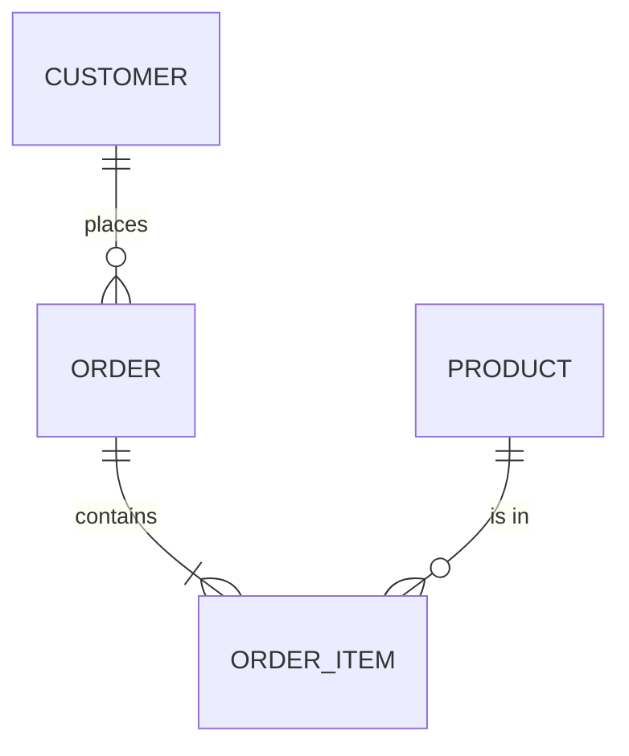

# DATA-MODEL.md

Copy this to the root of a project with a database as `DATA-MODEL.md`. It describes the
entities, relationships, and rules of the data, written from the schema that actually
exists. Update it in the same change as any migration. Never put real data, personal
records, or connection strings in this file.

## 1. Overview

- **Engine and version:** <!-- e.g. PostgreSQL, TBD (verify) -->
- **Migration tool and how migrations run:**
- **Where the schema lives in the repository:**

## 2. Entity Diagram

## 3. Entities

### `<table_or_collection>`

| Field | Type | Required | Notes |
| :--- | :--- | :--- | :--- |
| id | | yes | primary key |
| created_at | | yes | |

- **Indexes:** <!-- and the query each one serves -->
- **Constraints:** <!-- unique, foreign keys, checks -->
- **Owner (who may write):**

## 4. Rules

- **Money:** stored in the smallest currency unit, with a currency code.
- **Deletion:** <!-- soft delete or hard delete, and retention -->
- **State machines:** <!-- e.g. order: placed → paid → shipped → delivered; illegal moves rejected -->
- **Multi-tenant scoping:** <!-- if applicable, how rows are scoped -->

## 5. Personal Data

| Data | Where stored | Why needed | Retention | Law |
| :--- | :--- | :--- | :--- | :--- |
| <!-- phone, address --> | | | | <!-- NDPA, Ghana DPA --> |

## 6. Migrations Log

<!-- Number — what changed — reversible? — run against a real engine? -->
