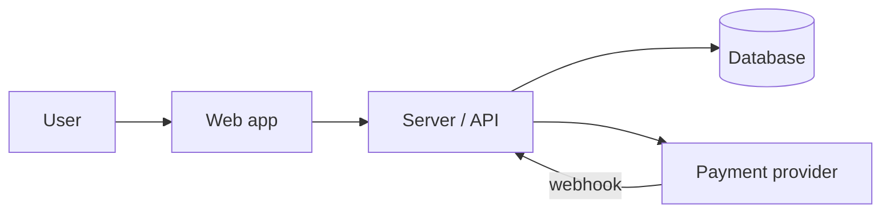

# ARCHITECTURE.md

Copy this to the root of a project as `ARCHITECTURE.md` once the stack is accepted. It
describes **how the system is built as it stands** — the living companion to the ADRs,
which record *why* each decision was made. Keep it accurate: when the structure changes,
update this file and add an ADR. Mark unknowns `TBD`. Never put secrets or real
connection strings in this file — name environment variables only.

## 1. Overview

<!-- Two or three sentences: what the system does and its overall shape (for example
     "a modular monolith: one Next.js app and a PostgreSQL database"). -->

## 2. Diagram

<!-- A text diagram anyone can edit (Mermaid or ASCII) showing components and data flow. -->



## 3. Stack

| Layer | Choice | Version | Notes |
| :--- | :--- | :--- | :--- |
| Front end | | TBD (verify) | |
| Back end | | TBD (verify) | |
| Database | | TBD (verify) | |
| Hosting / runtime | | | |
| CI / CD | | | |

## 4. Repository Structure

<!-- Where each kind of code lives, so every session builds in the same places. -->

```text
/
├── src/            # <what lives here>
├── docs/adr/       # decision records
└── ...
```

## 5. Components and Boundaries

| Component | Responsibility | Depends on | Must not |
| :--- | :--- | :--- | :--- |
| <!-- e.g. Orders module --> | | | <!-- e.g. call the payment provider directly --> |

## 6. Key Data Flows

<!-- One short numbered flow per important journey in SPEC.md (use the feature IDs). -->

1. **<Journey> (F#):** client → <component> → <component> → <outcome>

## 7. Data

- **Overview:** <!-- main entities and relationships; detail lives in DATA-MODEL.md -->
- **Migrations:** <!-- tool and how they run in deploys -->
- **Backups and retention:** <!-- TBD until hosting is decided -->

## 8. Authentication and Access

- **Sign-in method(s):**
- **Roles and where they are enforced:**
- **Session / token handling:**

## 9. Integrations and Webhooks

| Integration | Purpose | Handled by | Failure behavior |
| :--- | :--- | :--- | :--- |
| <!-- payment, email, SMS, WhatsApp, storage --> | | | <!-- retry, queue, alert --> |

## 10. Background Work

<!-- Queues, scheduled jobs, what runs outside the request, retry and dead-letter policy. -->

## 11. Environments and Configuration

| Environment | Purpose | Where it runs | Config source |
| :--- | :--- | :--- | :--- |
| Local | | | `.env.local` from `.env.example` |
| Staging | | | |
| Production | | | |

Environment variable **names** (values live in the secret store): <!-- list -->

## 12. Deployment

- **Topology:** <!-- servers, containers, regions -->
- **Pipeline:** <!-- build → test → deploy; who approves production -->
- **Rollback path:**

## 13. Observability and Security Boundaries

- **Logging, metrics, alerts, uptime checks:**
- **Trust boundaries:** <!-- what is public, what is internal, where input is validated -->
- **Sensitive data and where it is stored:**

## 14. Conventions

- **Naming and folder rules:**
- **Error response shape:**
- **Branching and commit style:**
- **Review rules:**

## 15. Non-Functional Targets

<!-- Performance, availability, and scale targets from SPEC.md, with how they are measured. -->

## 16. Risks and Open Questions

| # | Risk or question | Owner | Resolved by |
| :--- | :--- | :--- | :--- |

## 17. Change Log

<!-- Date — what changed in the structure — the ADR that records why. -->
